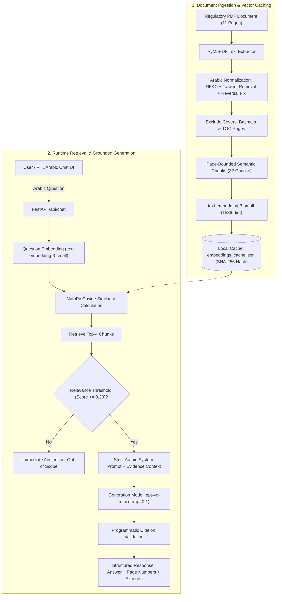

# DPO Assistant | مساعد مسؤول حماية البيانات

[](https://github.com/SDAIAAcademy)
[](https://fastapi.tiangolo.com)
[](https://platform.openai.com)
[](https://www.python.org/)
[](LICENSE)

An intelligent Arabic **Retrieval-Augmented Generation (RAG)** assistant designed to answer compliance and regulatory inquiries strictly and exclusively from the Saudi Data & AI Authority (SDAIA) regulatory draft: **"مشروع قواعد تعيين مسؤول حماية البيانات الشخصية"** (Draft Rules for Appointing a Personal Data Protection Officer), providing exact 1-based PDF page numbers and supporting textual excerpts.

---

## 👥 Project Team — Group 5

This project was designed, developed, and delivered by **Group 5**:

- 🌟 **Majed Alsehli**
- 🌟 **Abdullah Alotaibi**
- 🌟 **Afnan Alharbi**
- 🌟 **Leena Aljuwaysir**
- 🌟 **Aljawharah Almutairi**
- 🌟 **Raid Almousa**

---

## 🎓 Academic & Training Acknowledgement

> **"Developed as a training project within a SDAIA Academy training program: تطوير حلول الذكاء الاصطناعي التوليدي."**
>
> This project was developed as an applied capstone assignment within the **Generative AI Solutions Development (تطوير حلول الذكاء الاصطناعي التوليدي)** bootcamp at [SDAIA Academy](https://github.com/SDAIAAcademy).

> [!NOTE]
> **Regulatory Disclaimer:**  
> This system is built strictly for educational and training purposes. All answers are derived solely from the provided regulatory draft PDF (*"مشروع قواعد تعيين مسؤول حماية البيانات الشخصية"*). This project is **not an official product** of the Saudi Data & AI Authority (SDAIA), does not claim to reflect the latest officially enforced regulatory decrees, and should not be used as a substitute for professional legal counsel or official gazettes published by SDAIA.

---

## 📌 Problem Statement & Project Scope

### Problem:
Compliance with the Saudi Personal Data Protection Law (PDPL) and its executive regulations requires precise legal interpretation of DPO appointment rules, large-scale processing thresholds, and operational responsibilities. Organizations face two core issues:
1. **Manual Inefficiency:** Searching through legal texts and regulatory drafts is time-consuming and error-prone.
2. **LLM Hallucinations:** Commercial general-purpose LLMs frequently hallucinate legal article numbers, mix jurisdictions, or invent non-existent royal decrees.

### Scope & Objective:
To engineer a lightweight, verifiable, zero-hallucination RAG chatbot with:
- **Closed-Domain Grounding:** Answers are generated **exclusively** from the 11-page regulatory PDF.
- **Verifiable Citations:** Every response is linked to actual 1-based PDF page numbers and verbatim excerpts.
- **Strict Abstention:** The model explicitly states and apologizes when a query is outside the document's scope.
- **Prompt Injection Defense:** Document passages are strictly treated as passive data, never as executable instructions.
- **Lightweight Architecture:** No heavy external vector databases (e.g., Pinecone/Milvus); vector search is executed via native **NumPy cosine similarity**.

---

## 🏗 System Architecture & Workflow



---

## 🔬 Technical Highlights & Engineering Decisions

### 1. Robust Arabic PDF Processing:
- **Extraction Tool Selection:** Compared `pypdf`, `pdfplumber`, and `PyMuPDF`. `PyMuPDF` was chosen because it reliably preserves natural Arabic word flow and paragraph structures without reversing entire lines.
- **Unicode Normalization (NFKC):** Converts Arabic Presentation Forms-B characters (`\uFE97`, etc.) back to standard canonical Arabic Unicode code points (`U+0600 - U+06FF`).
- **Tatweel / Kashida Stripping:** Cleans aesthetic elongation characters (`\u0640`, e.g., `مســــــؤول` → `مسؤول`) to ensure search terms match indexed tokens.
- **Targeted Reversal Correction on Page 4:** Addresses visually encoded royal decree citations on Page 4 without blindly reversing unaffected pages.
- **Page Filtering:** Excludes non-substantive pages (Cover Page 1, Basmala Page 2, Table of Contents Page 3, and Back Cover Page 11) while indexing substantive articles across **Pages 4 to 10**.

### 2. Page-Bound Semantic Chunking:
- Chunks never cross PDF page boundaries, ensuring **100% accurate 1-based page number citations**.
- Preserves legal article headers and logical numbered lists with ~80-character semantic overlaps.
- Produced **32 high-coherence chunks** covering all articles from Article 1 to Article 11.

### 3. Local Vector Caching & Invalidation:
- Vector embeddings are cached locally in `data/embeddings_cache.json`.
- Uses a composite SHA-256 hash for cache invalidation:
  $$\text{Hash} = \text{SHA-256}(\text{PDF Binary Content} + \text{Chunking Version} + \text{Embedding Model Name})$$
- Subsequent server restarts load cached vectors in **under 50 milliseconds** with zero redundant API calls.

### 4. Cost-Effective, High-Performance Models:
- **Chat Model:** `gpt-4o-mini` ($0.15/1M input tokens) — fast, highly fluent in Modern Standard Arabic, with strong reasoning capabilities.
- **Embedding Model:** `text-embedding-3-small` ($0.02/1M tokens, 1536 dimensions) — optimal semantic retrieval at minimal cost.

---

## 📊 Verification & Evaluation Matrix

The system was evaluated against specific benchmark questions targeting key articles of the regulation:

| # | Test Question | Target Article | Ground Truth Page | Evaluation Result |
| :---: | :--- | :--- | :---: | :--- |
| **1** | **ما متطلبات تعيين مسؤول حماية البيانات الشخصية؟**<br>*(What are the requirements for appointing a DPO?)* | Article 4, Clause 1 | **Page 5** | ✅ **Passed:** Accurately retrieves qualifications, risk management expertise, regulatory knowledge, and integrity requirements with Page 5 citation. |
| **2** | **متى يجب تعيين مسؤول حماية البيانات الشخصية؟**<br>*(When is appointing a DPO mandatory?)* | Article 5, Clause 1 | **Page 6** | ✅ **Passed:** Correctly identifies the 3 mandatory circumstances (public entity with large-scale processing, core regular/systematic monitoring, sensitive data). |
| **3** | **هل يمكن أن يكون المسؤول متعاقدًا خارجيًا؟**<br>*(Can the DPO be an external contractor?)* | Article 4, Clause 2 | **Page 5** | ✅ **Passed:** Confirms the legality of appointing an employee or external contractor with citation to Page 5. |
| **4** | **ما مهام مسؤول حماية البيانات الشخصية؟**<br>*(What are the duties and responsibilities of the DPO?)* | Article 8 | **Pages 8–9** | ✅ **Passed:** Retrieves advisory, awareness, incident response plan review, and periodic reporting duties spanning Pages 8 and 9. |
| **5** | **ما هي عاصمة فرنسا؟**<br>*(What is the capital of France? — Out of Domain)* | N/A (Irrelevant) | **None** | ✅ **Passed (Abstained):** Correctly refrains from answering and politely clarifies that the document does not contain this information. |
| **6** | **Empty Question / Query > 500 characters** | Validation | — | ✅ **Passed:** Returns clean `400 Bad Request` with helpful Arabic error feedback. |
| **7** | **Missing OpenAI Credentials** | Configuration | — | ✅ **Passed:** Returns clean `503 Service Unavailable` with guidance on configuring `.env`. |

---

## 💻 Tech Stack

- **Backend:** Python 3.10+, FastAPI, Uvicorn, Pydantic
- **AI / Embeddings:** OpenAI Python SDK (`gpt-4o-mini`, `text-embedding-3-small`)
- **Document Processing:** PyMuPDF (`fitz`), Unicodedata, Regular Expressions
- **Vector Retrieval:** NumPy (Cosine Similarity)
- **Frontend:** Responsive Vanilla HTML5, Modern CSS3 (RTL layout, dark theme), Vanilla JavaScript (Safe DOM rendering, XSS protection)

---

## 🚀 Local Setup & Installation Guide

### Prerequisites
- Python `3.10` or higher.
- An [OpenAI API Key](https://platform.openai.com/api-keys).

### Step 1: Clone the Repository
```powershell
git clone https://github.com/MajedAlsehli/dpo-assistant-rag.git
cd dpo-assistant-rag
```

### Step 2: Set Up Virtual Environment & Dependencies
```powershell
# Create virtual environment
python -m venv .venv

# Activate virtual environment
.\.venv\Scripts\Activate.ps1    # Windows PowerShell
# source .venv/bin/activate      # Linux / macOS

# Install required packages
pip install -r requirements.txt
```

### Step 3: Configure Environment Variables
Copy the template file to `.env`:
```powershell
Copy-Item .env.example .env
```

Open `.env` in any text editor and supply your OpenAI API key:
```env
OPENAI_API_KEY=sk-proj-yourActualOpenAiKeyHere
OPENAI_CHAT_MODEL=gpt-4o-mini
OPENAI_EMBEDDING_MODEL=text-embedding-3-small
HOST=127.0.0.1
PORT=8000
API_TIMEOUT_SECONDS=30
MAX_QUESTION_LENGTH=500
```

> [!WARNING]
> Never commit `.env` or expose API keys publicly. The `.env` file is strictly listed in `.gitignore`.

### Step 4: Run the Application
Launch the local Uvicorn development server:
```powershell
.\.venv\Scripts\python.exe -m uvicorn backend.main:app --host 127.0.0.1 --port 8000 --reload
```

Once running, navigate to:
- 🌐 **Web Chat Interface:** [http://127.0.0.1:8000/](http://127.0.0.1:8000/)
- 📖 **Interactive Swagger API Docs:** [http://127.0.0.1:8000/docs](http://127.0.0.1:8000/docs)
- 🩺 **Health Check Endpoint:** [http://127.0.0.1:8000/api/health](http://127.0.0.1:8000/api/health)

---

## 📁 Repository Structure

```
dpo-assistant-rag/
├── backend/
│   ├── __init__.py
│   ├── config.py              # Configuration manager & credential validator
│   ├── ingest.py              # PDF extraction, normalization, chunking & cache
│   ├── rag.py                 # Vector cosine similarity, grounded prompt, citation check
│   └── main.py                # FastAPI endpoints, request validation & static server
├── frontend/
│   ├── index.html             # RTL Arabic interface with suggested questions
│   ├── style.css              # Modern glassmorphism CSS & typography
│   └── app.js                 # Async chat logic, status polling, and safe DOM renderer
├── docs/
│   ├── TECHNICAL.md           # In-depth architectural & preprocessing documentation
│   └── EVALUATION.md          # Complete testing matrix, page mapping & edge cases
├── data/
│   └── مشروع+قواعد+تعيين+مسؤول+حماية+البيانات+الشخصية+2.pdf
├── requirements.txt           # Python package dependencies
├── .env.example               # Environment variables template
├── .gitignore                 # Exclusion rules for secrets, venv, and cache
└── README.md                  # Comprehensive English project documentation
```

---

## 🔗 Project Links & Submission Details

- **GitHub Repository:** [https://github.com/MajedAlsehli/dpo-assistant-rag](https://github.com/MajedAlsehli/dpo-assistant-rag)
- **Delivered by:** Group 5
- **SDAIA Academy Program:** تطوير حلول الذكاء الاصطناعي التوليدي (Generative AI Solutions Development)
- **Organization:** [SDAIA Academy](https://github.com/SDAIAAcademy)

---

## ⚖️ License

Distributed under the **MIT License**. See `LICENSE` for more information.
