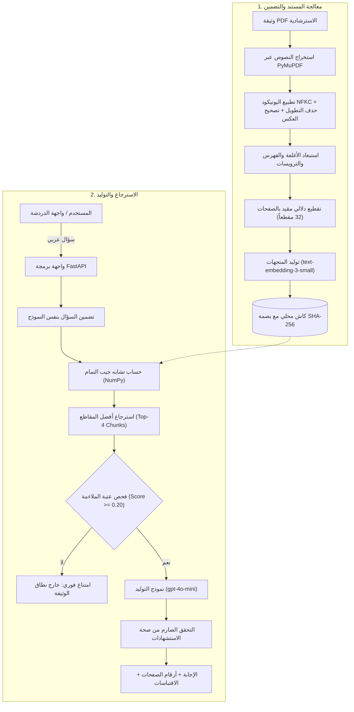

# DPO Assistant | مساعد مسؤول حماية البيانات

[](https://github.com/SDAIAAcademy)
[](https://fastapi.tiangolo.com)
[](https://platform.openai.com)
[](https://www.python.org/)

نظام استرجاع ذكي معزز بالتوليد (**Retrieval-Augmented Generation - RAG**) يجيب عن الأسئلة القانونية والتنظيمية باللغة العربية بالاعتماد الحصري على وثيقة **"مشروع قواعد تعيين مسؤول حماية البيانات الشخصية"**، مع توثيق الإجابات بدقة استناداً إلى أرقام الصفحات الحقيقية والاقتباسات النصية الصريحة.

---

## 🎓 إقرار التدريب والصفة الأكاديمية (Training Acknowledgement)

> **"Developed as a training project within a SDAIA Academy training program: تطوير حلول الذكاء الاصطناعي التوليدي."**
>
> تم تطوير هذا المشروع كمتطلب تدريبي تطبيقي ضمن برنامج **تطوير حلول الذكاء الاصطناعي التوليدي** المقدم من [أكاديمية سدايا (SDAIA Academy)](https://github.com/SDAIAAcademy).

> [!NOTE]
> **إخلاء مسؤولية تنظيمي:**  
> هذا المشروع مخصص لأغراض تعليمية وتدريبية، وتعتمد إجاباته حصراً على نصوص مسودة الوثيقة الاسترشادية المرفقة ("مشروع قواعد تعيين مسؤول حماية البيانات الشخصية"). هذا المشروع **ليس منتجاً رسمياً** للهيئة السعودية للبيانات والذكاء الاصطناعي (سدايا)، ولا يزعم تمثيل أحدث القواعد التنظيمية المعتمدة رسمياً في المملكة، ولا يُعد بديلاً عن الاستشارة القانونية المتخصصة أو مراجعة اللوائح الرسمية الصادرة عن الهيئة.

---

## 📌 المشكلة والهدف (Problem Statement & Scope)

### المشكلة:
تتضمن التنظيمات الوطنية لحماية البيانات الشخصية اشتراطات وضوابط دقيقة (مثل أحوال التعيين الإلزامية، ومعايير المعالجة واسعة النطاق، ومواصفات مسؤول الحماية). وتواجه المؤسسات تحديين رئيسيين:
1. بطء البحث اليدوي في المستندات واللوائح الطويلة.
2. ميل نماذج الذكاء الاصطناعي العامة (LLMs) إلى "الهلوسة" وتلفيق أرقام مواد ومراسيم غير موجودة عند سؤالها عن أطر نظامية محددة.

### الحل والهدف:
تطوير مساعد RAG خفيف وموجّه يحقق:
- **الانغلاق المعرفي التام (Closed-Domain Grounding)**: استخراج الإجابات من الوثيقة المحددة فقط دون إضافة أي معلومات خارجية.
- **التوثيق الحقيقي للصفحات (1-Based Page Citations)**: دعم كل إجابة برقم الصفحة الفعلية في ملف PDF واقتباس نصي مؤكد.
- **الامتناع الصارم (Strict Abstention)**: الاعتذار الواضح والتصريح عند غياب المعلومة عن المستند، لمنع الهلوسة منعاً باتاً.
- **الحماية من الحقن (Injection Defense)**: معاملة نصوص الوثيقة كبيانات استرشادية فقط، وعدم تنفيذ أي تعليمات داخلية.
- **كفاءة معمارية عالية**: عدم الاعتماد على قواعد بيانات متجهات خارجية ثقيلة، بل توظيف حساب تشابه جيب التمام المباشر عبر `NumPy`.

---

## 🏗 المعمارية وسير العمل (System Architecture)



---

## 💡 أبرز الحلول التقنية المطبقة (Technical Highlights)

### 1. معالجة تحديات استخراج النصوص العربية من PDF:
- **اختيار المحرك الأنسب**: أظهرت المقارنة العملية أن مكتبة `PyMuPDF` تحافظ على الترتيب المنطقي للكلمات العربية بدقة أعلى بكثير من `pypdf` أو `pdfplumber` (اللذين عانيا من تفكك الكلمات أو عكس اتجاه السطور بالكامل).
- **التطبيع القياسي (NFKC)**: تحويل أشكال العرض التقديمية (Arabic Presentation Forms) إلى نطاق اليونيكود العربي الموحد.
- **إزالة التطويل (Tatweel Removal)**: تنظيف الكشيدة الزخرفية لضمان مطابقة الكلمات المفتاحية بدقة أثناء البحث.
- **تصحيح العكس البصري لصفحة 4**: معالجة أسطر الاستناد للمراسيم الملكية دون تطبيق عكس أعمى لبقية الصفحات.

### 2. التقطيع الدلالي المقيد بالصفحات (Page-Bound Chunking):
- كل مقطع ينتمي حصراً إلى صفحة واحدة من المستند الأصلي، لضمان دقة الاستشهاد برقم الصفحة الأصلية.
- الحفاظ على كتل المواد القانونية مجتمعة مع نسبة تداخل مناسبة (80 حرفاً) لمنع انقطاع السياق.
- تم إنتاج **32 مقطعاً دلالياً** تغطي كافة مواد القواعد الموضوعية من صفحة 4 إلى 10.

### 3. التخزين المؤقت الذكي مع إبطال الكاش (Cache Invalidation):
- تخزين المتجهات في ملف محلي `data/embeddings_cache.json`.
- استخدام بصمة رقمية مركبة (SHA-256) تجمع بين:
  $$\text{Hash} = \text{SHA-256}(\text{محتوى PDF الثنائي} + \text{إصدار التقطيع} + \text{اسم نموذج التضمين})$$
- يتم استرجاع المتجهات في أقل من 50 مللي ثانية، وتُعاد الفهرسة تلقائياً فقط عند تعديل المستند أو الإعدادات.

### 4. النماذج المختارة:
- **نموذج التوليد (Chat Model)**: `gpt-4o-mini` — فائق السرعة، عالي الدقة في الصياغة العربية، واقتصادي التكلفة.
- **نموذج التضمين (Embedding Model)**: `text-embedding-3-small` — بأبعاد 1536، يقدم أداءً استرجاعياً ممتازاً بتكلفة رمزية.

---

## 🖥 واجهة المستخدم (Web Interface)

تتضمن الواجهة تصميماً حديثاً يدعم اللغة العربية بشكل كامل (RTL):
- **أسئلة مقترحة للاختبار السريع**: أزرار جاهزة لأهم أسئلة التقييم (متطلبات التعيين، أحوال التعيين، المتعاقد الخارجي، المهام).
- **بطاقات المصادر والاقتباسات**: عرض أرقام الصفحات الحقيقية ومعرفات المقاطع والاقتباسات النصية أسفل الإجابة.
- **تصيير آمن للنصوص (Safe DOM Rendering)**: حماية تامة من ثغرات حقن النصوص البرمجية (XSS).
- **مؤشر حالة النظام**: إشعار المستخدم فوراً بحالة الربط وجاهزية المفاتيح وعدد المقاطع المفهرسة.

---

## 📊 نتائج الاختبار والتقييم (Evaluation Matrix)

| السؤال الاختباري | المادة النظامية | الصفحة في PDF | النتيجة المحققة |
| :--- | :--- | :---: | :--- |
| **ما متطلبات تعيين مسؤول حماية البيانات الشخصية؟** | المادة الرابعة (الفقرة 1) | **صفحة 5** | ✅ استرجاع متطلبات المؤهل العلمي، والخبرة، وإدارة المخاطر، والمتطلبات النظامية، والنزاهة بدقة مع الاستشهاد بصفحة 5. |
| **متى يجب تعيين مسؤول حماية البيانات الشخصية؟** | المادة الخامسة (أولاً) | **صفحة 6** | ✅ استرجاع الحالات الإلزامية الثلاث (الجهة العامة ذات المعالجة الواسعة، المراقبة المنتظمة، البيانات الحساسة) من صفحة 6. |
| **هل يمكن أن يكون المسؤول متعاقدًا خارجيًا؟** | المادة الرابعة (الفقرة 2) | **صفحة 5** | ✅ تأكيد جواز كونه موظفاً أو متعاقداً خارجياً استناداً إلى نص الفقرة في صفحة 5. |
| **ما مهام مسؤول حماية البيانات الشخصية؟** | المادة الثامنة | **صفحات 8–9** | ✅ استرجاع مهام الدعم والتوعية وإعداد التقارير ومراجعة خطط التسرب من الصفحتين 8 و 9. |
| **سؤال خارج الوثيقة (مثل: ما هي عاصمة فرنسا؟)** | خارج النطاق | **لا يوجد** | ✅ امتناع صريح واعتذار لعدم توفر المعلومة في الوثيقة دون هلوسة أو اختلاق مصادر. |
| **إدخال فارغ أو أسئلة تتجاوز 500 حرف** | فحص المدخلات | — | ✅ إرجاع خطأ `400 Bad Request` برسائل إرشادية واضحة. |
| **غياب مفتاح الـ API** | فحص الإعدادات | — | ✅ إرجاع خطأ `503 Service Unavailable` مع تعليمات الضبط. |

---

## 🚀 التثبيت والتشغيل المحلي (Setup & Run Guide)

### 1. المتطلبات الأساسية:
- بيئة بايثون `Python 3.10` أو أحدث.
- مفتاح صالح لخدمة `OpenAI API`.

### 2. خطوات التثبيت:

```powershell
# استنساخ المستودع
git clone https://github.com/MajedAlsehli/dpo-assistant-rag.git
cd dpo-assistant-rag

# إنشاء البيئة الافتراضية وتفعيلها
python -m venv .venv
.\.venv\Scripts\Activate.ps1   # لأنظمة Windows
# source .venv/bin/activate     # لأنظمة Linux/macOS

# تثبيت الحزم المطلوبة
pip install -r requirements.txt
```

### 3. ضبط متغيرات البيئة:

انسخ نموذج الإعدادات إلى ملف `.env`:
```powershell
Copy-Item .env.example .env
```

افتح ملف `.env` وأضف مفتاح OpenAI API الخاص بك:
```env
OPENAI_API_KEY=sk-proj-yourActualOpenAiKeyHere
OPENAI_CHAT_MODEL=gpt-4o-mini
OPENAI_EMBEDDING_MODEL=text-embedding-3-small
HOST=127.0.0.1
PORT=8000
API_TIMEOUT_SECONDS=30
MAX_QUESTION_LENGTH=500
```

### 4. تشغيل الخادم:

```powershell
.\.venv\Scripts\python.exe -m uvicorn backend.main:app --host 127.0.0.1 --port 8000 --reload
```

- 🌐 **رابط التطبيق**: [http://127.0.0.1:8000/](http://127.0.0.1:8000/)
- 📖 **توثيق Swagger التفاعلي**: [http://127.0.0.1:8000/docs](http://127.0.0.1:8000/docs)
- 🩺 **فحص الحالة (Health API)**: [http://127.0.0.1:8000/api/health](http://127.0.0.1:8000/api/health)

---

## 📁 هيكل المشروع (Repository Structure)

```
dpo-assistant-rag/
├── backend/
│   ├── __init__.py
│   ├── config.py              # إدارة الإعدادات والتحقق من المفاتيح
│   ├── ingest.py              # محرك استخراج ومعالجة وتطبيع وتقطيع PDF
│   ├── rag.py                 # استرجاع المتجهات، الموجه الصارم، والتحقق من الاستشهادات
│   └── main.py                # تطبيق FastAPI ونقاط النهاية وخدمة الواجهة
├── frontend/
│   ├── index.html             # واجهة المستخدم العربية المتجاوبة (RTL)
│   ├── style.css              # التصميم والأنماط البصرية الحديثة
│   └── app.js                 # منطق التفاعل غير المتزامن والتصيير الآمن
├── docs/
│   ├── TECHNICAL.md           # التوثيق التقني والمعماري المفصل
│   └── EVALUATION.md          # تقرير التقييم واختبارات حالات الحافة
├── data/
│   └── مشروع+قواعد+تعيين+مسؤول+حماية+البيانات+الشخصية+2.pdf
├── requirements.txt           # مكتبات المشروع
├── .env.example               # نموذج متغيرات البيئة
├── .gitignore                 # استثناء الملفات الحساسة والبيئات الافتراضية
└── README.md                  # دليل المشروع الرئيسي
```

---

## 👨‍💻 مطور المشروع (Developer)

- **الاسم**: ماجد السهلي (Majed Alsehli)
- **حساب GitHub**: [@MajedAlsehli](https://github.com/MajedAlsehli)
- **المستودع**: [https://github.com/MajedAlsehli/dpo-assistant-rag](https://github.com/MajedAlsehli/dpo-assistant-rag)
- **البرنامج التدريبي**: تطوير حلول الذكاء الاصطناعي التوليدي — أكاديمية سدايا (SDAIA Academy).
